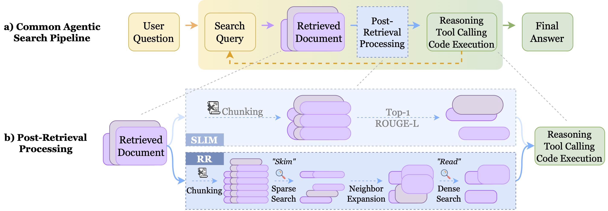
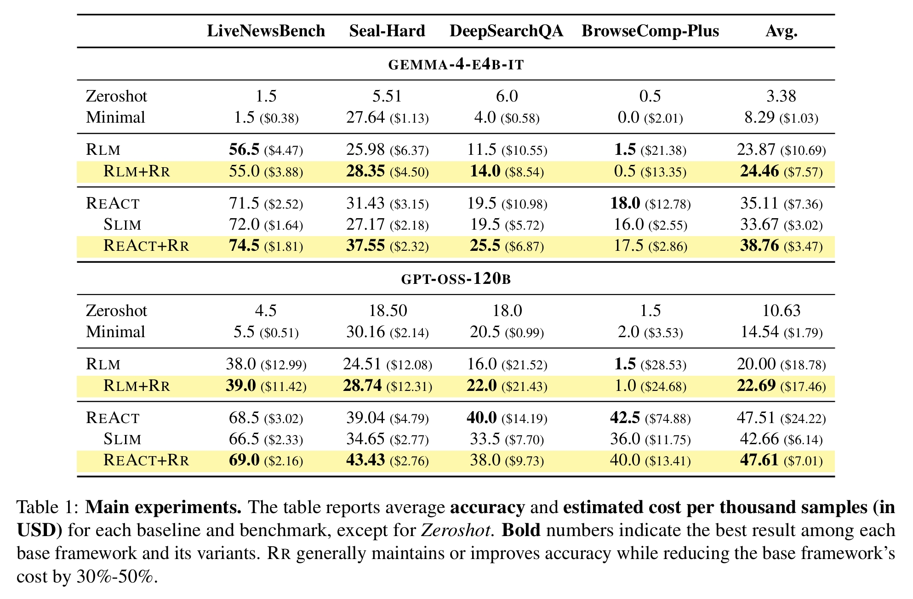

# Skim Before You Reason: Half the Cost, Similar Accuracy in Agentic Search

Our method applies hybrid retrieval on the retrieved web documents to cut the cost of the search agent by 50% at equal or better accuracy. 
Evaluated on LiveNewsBench, Seal-Hard, DeepSearchQA, BrowseComp-Plus.

> [!NOTE] 
> `Retrive-from-the-retrieved` (in short, `RR`) is our method name.





## Setup

Clone this repository and install the Python dependencies. Tested with Python 3.12.

```bash
git clone https://github.com/vtpss/retrieve-from-the-retrieved
cd retrieve-from-the-retrieved
pip install -r requirements.txt
```

As the package `ddgs` (for DuckDuckGo search) is not always stable, we use a local search server `openserp` as an alternative.

```bash
# start the local search server (used when duckduckgo is not available)
bash scripts/install_openserp.sh
export OPENSERP_PORT=7000
nohup ../openserp/openserp serve -p ${OPENSERP_PORT} > ../openserp/openserp_log.txt 2>&1 &
sleep 5s
curl "http://localhost:${OPENSERP_PORT}/mega/search?text={Python}&engines=duckduckgo&limit=1"
```

## Run samples

```bash
# setup your LiteLLM keys
export LITELLM_BASE_URL=end_point     # "http://localhost:8000/v1"
export LITELLM_MODEL=your_model_name  # "hosted_vllm/gemma-4-E4B-it"
export LITELLM_API_KEY=your_api_key   # optional for local-hosted models via vLLM/llama.cpp/etc.

# run the agent on samples. Comparing ReAct and ReAct+RR (our method) on the same queries.
python -m agent.react
python -m agent.main
```


## Evaluation code (to be updated)

> [!NOTE] 
> Our RR method use dense vector search, which requires a GPU for deployment. 
> If you don't have a GPU, you can skip the dense vector search of RR with the setting `Sparse+N.E.`, 
> as detailed in the `Ablation Study` section in the [paper](./assets/Skim-Before-You-Reason.pdf).

```bash
# deploy the inference and the judge models if needed. Use a DIFFERENT Python env
# bash scripts/deploy_llms.sh

# run the evaluation on LiveNewsBench, Seal-Hard, DeepSearchQA
bash scripts/eval.sh
```
